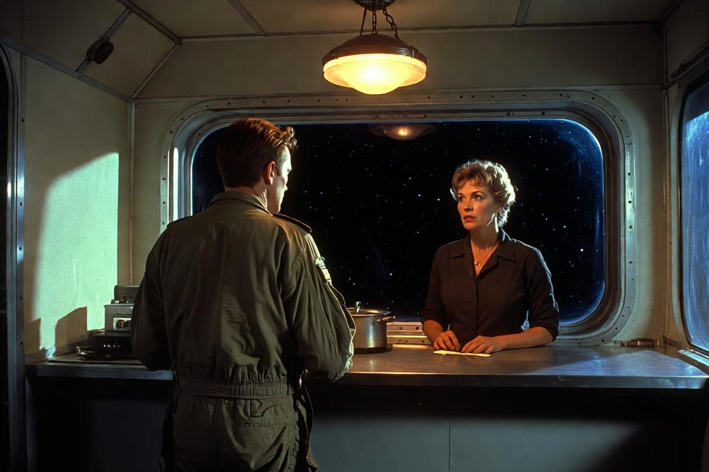

Margarete mantenía el letrero de un restaurante en un rincón de la galaxia al que las naves llegaban casi siempre por error y casi nunca por segunda vez. Decir que lo mantenía es generoso. Lo miraba todas las mañanas, lo limpiaba cuando hacía falta y sabía mejor que nadie lo que decía. Lo que no podía hacer era cambiarlo. Aquel día, como desde hacía meses, el letrero decía una sola cosa: que se servía sopa.

No había sopa. Margarete lo sabía. La cocina lo sabía. Probablemente lo sabía hasta la olla. El único que no lo sabía era el letrero, y el letrero no dependía de Margarete sino de una oficina en otro planeta, que era la única autorizada a decidir qué anunciaban los letreros de aquel sector. Margarete había enviado la corrección tres veces. La oficina abría los martes alternos de un calendario que nadie más usaba. El encargado podía estar de vacaciones, o muerto, o simplemente convencido de que un letrero que cambia es un letrero en el que nadie confía. Las tres veces recibió el mismo acuse: su solicitud había sido registrada y sería atendida en riguroso orden de llegada, lo cual, dada la velocidad de la luz y la de la oficina, no era una promesa sino una descripción del universo.

Una nave llegó un jueves. El piloto había organizado la tarde alrededor de la sopa, que es el tipo de plan que solo parece pequeño hasta que falla. Entró, la pidió, y Margarete le explicó, con la amabilidad de quien ya ha tenido esta conversación, que la sopa era un error. No un error de la cocina. Un error del letrero. Y que el letrero no era suyo, aunque estuviera clavado en su pared.

:::figure[Margarete tacha la sopa del letrero. El piloto mira.]

:::

El piloto no se sorprendió. Había cruzado más sistemas de los que la mayoría de la gente sabe nombrar y había visto letreros que anunciaban puertos ya demolidos, tarifas de otro siglo y, en una ocasión memorable, un planeta entero que había decidido no existir los fines de semana. Había aprendido que el problema casi nunca es el letrero. Es quién tiene permiso para tocarlo. Así que, en lugar de quejarse, que es lo que hacen los viajeros con menos kilómetros, sacó del bolsillo un aparato parecido a una tableta, algo gastado, con letras grandes y amables en la tapa.

Era, explicó, una ventana a una red parecida a internet, pero mejor: una red que conectaba todo lo que había en el universo, desde los puertos más lejanos hasta los restaurantes a los que nadie llegaba a propósito. Funcionaba gracias al *Infinite Improbability Drive*, que casi todo el mundo, en casi todas partes, llamaba simplemente Protocolo 42: el mismo mecanismo que movía su nave y que consiste, en resumen, en conseguir que lo que casi nunca pasa pase justo cuando hace falta. Gracias a él se habían resuelto muchos de los grandes problemas del universo, o por lo menos todos los que consistían en esperar a que alguien, en otro planeta, diera permiso.

El piloto le mostró cómo funcionaba. El letrero ya no dependía de la oficina: vivía en un registro compartido que todos podían leer. Cada cambio quedaba escrito, con el nombre de quien lo hacía, en un orden que cualquiera podía seguir. Y quien tenía algo que corregir lo corregía a la vista de todos.

Margarete esperó a que alguien le pidiera un formulario. Nadie se lo pidió. Escribió la corrección en la tableta del piloto, en el mismo registro donde vivía el letrero, con su nombre al lado, y ese mismo día las naves que se acercaban leyeron un aviso nuevo: hoy no hay sopa. Nadie tuvo que creer al piloto. Nadie tuvo que creer a Margarete. Nadie tuvo que esperar a la oficina. Bastaba con mirar el letrero.

Como era de esperar, alguien preguntó si la sopa había existido alguna vez. El registro tenía la respuesta: primero el letrero que anunciaba sopa y después la corrección de Margarete, cada cosa en su orden.

Semanas más tarde llegó al restaurante una carta de la oficina del otro planeta, en papel y con tres sellos, para avisar de que la solicitud seguía en cola. Margarete la leyó, la dobló con cuidado y la usó para calzar la mesa que cojeaba, que fue lo más útil que la oficina había hecho por el restaurante en años.

En el registro, Margarete añadió una última nota, pequeña: todo aquello había ocurrido un jueves. En eso, por una vez, todo el mundo estuvo de acuerdo.
