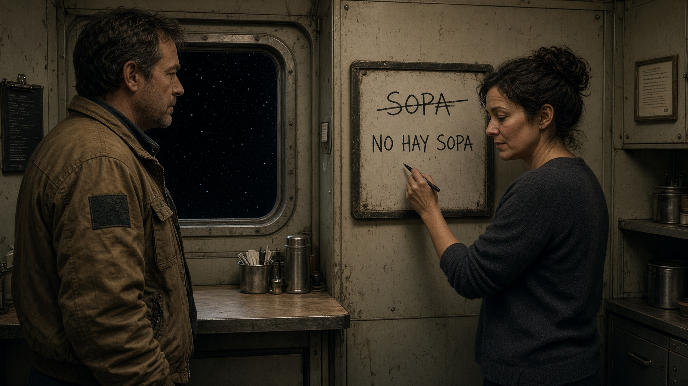

Fenella mantenía el letrero de un restaurante en un rincón de la galaxia al que las naves llegaban casi siempre por error y casi nunca por segunda vez. Lo actualizaba con un cuidado que el lugar no siempre merecía. Aquel día el letrero decía tres cosas: que había sitio, que la cocina estaba abierta y que se servía sopa.

Una nave llegó un martes. El piloto había organizado la tarde alrededor de la sopa, que es el tipo de plan que solo parece pequeño hasta que falla. Entró, la pidió, y le explicaron, con la amabilidad de quien ya ha tenido esta conversación, que la sopa había sido un error. No un error de la cocina. Un error del letrero. Llevaba meses anunciando un plato que nadie preparaba.

:::figure[Fenella tacha la sopa del letrero. El piloto mira.]

:::

En el orden antiguo, Fenella habría enviado la corrección a una oficina de otro planeta. La oficina podía estar cerrada. El encargado podía estar de vacaciones, o muerto, o simplemente convencido de que no convenía alentar a los pilotos. Fenella se habría enterado meses después, que es el tiempo que tarda una sopa inexistente en volverse fama.

Con el protocolo, el piloto no tuvo que esperar a esa oficina y Fenella no tuvo que heredar el error en silencio. La corrección quedó escrita en el mismo registro que el letrero, en un orden que cualquiera podía seguir, y el anuncio que las naves leían al acercarse pasó a decir, aquel mismo día, que de sopa no había. No hacía falta creer al piloto. No hacía falta creer a Fenella. Había que mirar.

Hubo, como era de esperar, una discusión sobre si la sopa había existido alguna vez. El registro guardó las dos versiones, primero la del letrero y después la del piloto, que es la única manera decente de tratar un plato disputado. Fenella dejó al final una nota más pequeña: el restaurante seguía en el mismo rincón de la galaxia, y había sitio en las mesas. En eso, por una vez, todo el mundo estuvo de acuerdo.
